# Muhammad Al-Muzahid

**Software Engineer · AI & ML Researcher · Competitive Programmer**

I build software systems and full-stack products, and research machine learning for imbalanced data. Currently pursuing an M.Sc. Engg. in ICT at **BUET**, with a background in Computer Science and Engineering from **PSTU**.

[Portfolio](https://almuzahidseyam.tech/) &nbsp; / &nbsp; [Download CV](./assets/software-engineer-cv.pdf) &nbsp; / &nbsp; [LinkedIn](https://www.linkedin.com/in/almuzahidseyam/) &nbsp; / &nbsp; [Email](mailto:almuzahid16@gmail.com)

**3× ICPC regionalist** &nbsp; · &nbsp; **2,600+ problems solved** &nbsp; · &nbsp; **Published in IEEE Xplore**

## Selected projects

### Formly
Build and publish conversational forms, embed them on another website, and review responses stored in PostgreSQL. Published snapshots keep live forms stable while drafts change. 
TypeScript · Next.js · React · PostgreSQL 
[Code](https://github.com/almuzahidseyam/formly-chat-forms) &nbsp; / &nbsp; [Try the demo](https://formly-chat-forms.vercel.app/demo)

### BD_TSP
Compare exact Held–Karp tours for a 15-hub distance matrix with heuristic routes across 64 districts in Bangladesh. Combines a C++ solver, directed road distances and interactive maps. 
C++17 · Python · OSRM · Folium 
[Code](https://github.com/almuzahidseyam/BD_TSP) &nbsp; / &nbsp; [Methods & examples](https://github.com/almuzahidseyam/BD_TSP#choose-a-demonstration)

### LumaWeave
Add gesture-controlled visual effects to your Google Meet camera feed. Bundled MediaPipe models track hands locally, and a frame-driven rendering pipeline returns the processed video to Meet. 
JavaScript · MediaPipe · Canvas · Chrome Extensions 
[Code](https://github.com/almuzahidseyam/lumaweave) &nbsp; / &nbsp; [Preview](https://github.com/almuzahidseyam/lumaweave/blob/main/docs/preview.png) &nbsp; / &nbsp; [Download](https://github.com/almuzahidseyam/lumaweave/releases/latest)

[Explore all repositories →](https://github.com/almuzahidseyam?tab=repositories&sort=stargazers)

## Research

**[DASS: Density-Adaptive Synthetic Sampling for Improved Imbalanced Classification](https://doi.org/10.1109/STI64222.2024.10951098)** 
Published in IEEE Xplore, 6th International Conference on Sustainable Technologies for Industry 5.0. 
[Paper](https://doi.org/10.1109/STI64222.2024.10951098) &nbsp; / &nbsp; [Citation & project page](https://github.com/almuzahidseyam/DASS) 
Imbalanced classification · Density estimation · Synthetic sampling

**M.Sc. thesis — Attention-Driven Hierarchical Active Learning Framework for Robust Imbalanced Classification** 
Deep learning · Active learning · Attention mechanisms

## Competitive programming

- **ICPC Asia Dhaka Regionalist** — 2023, 2024, 2025
- **NCPC Finalist** — 2023
- **3rd place**, PSTU Independence Day Programming Contest — 2024
- **National Undergraduate Mathematics Olympiad Awardee**

[Codeforces](https://codeforces.com/profile/brainsoft) &nbsp; / &nbsp; [LeetCode](https://leetcode.com/u/brainsoft/) &nbsp; / &nbsp; [Solutions & algorithm library](https://github.com/almuzahidseyam/CompetitiveProgrammingRepository)

Additional programming highlights

CodeChef: **3★ (1745)** · AtCoder: **456** · BeeCrowd: **Top 1% globally** 
Recorded profile highlights; live ratings may change.

## Technical toolkit

| Area | Main tools |
| :--- | :--- |
| **Languages** | C++ · Python · TypeScript · JavaScript |
| **Web & data** | React · Next.js · Node.js · PostgreSQL · SQLite |
| **Applied ML** | PyTorch · MediaPipe |
| **Development** | Docker · Linux · Git · GitHub Actions |

Additional languages & tools

C · Java · PHP · Dart · Flutter · HTML · CSS · Tailwind CSS · Express · MySQL · Redis · TensorFlow · Jupyter · LaTeX

## Education

- **BUET** — M.Sc. Engg. in Information and Communication Technology · May 2025 – Present
- **PSTU** — M.Sc. in Computer Science and Information Technology · Jan 2025 – Apr 2026
- **PSTU** — B.Sc. Engg. in Computer Science and Engineering · Jan 2019 – Dec 2024

## More from my GitHub

Contribution activity

<picture>
  <source media="(prefers-color-scheme: dark)" srcset="https://raw.githubusercontent.com/almuzahidseyam/almuzahidseyam/output/github-contribution-grid-snake-dark.svg">
  
</picture>

  

Recently updated repositories

<!-- LATEST_REPOS_START -->
| Project | Last updated |
| :--- | :--- |
| [cf-practice-ladder](https://github.com/almuzahidseyam/cf-practice-ladder) | Nov 04, 2026 |
| [profemail-saas](https://github.com/almuzahidseyam/profemail-saas) | Nov 04, 2026 |
| [fieldwork-commerce](https://github.com/almuzahidseyam/fieldwork-commerce) | Nov 04, 2026 |
| [diffdrive_odom_demo](https://github.com/almuzahidseyam/diffdrive_odom_demo) | Nov 04, 2026 |
| [nokia-3310-snake](https://github.com/almuzahidseyam/nokia-3310-snake) | Nov 04, 2026 |
<!-- LATEST_REPOS_END -->

---

[Get in touch](mailto:almuzahid16@gmail.com) &nbsp; · &nbsp; [Facebook](https://www.facebook.com/muhammadalmuzahid/) &nbsp; · &nbsp; [Support my work](https://www.buymeacoffee.com/almuzahidseyam)

   
  Building, learning, solving — one step at a time.

